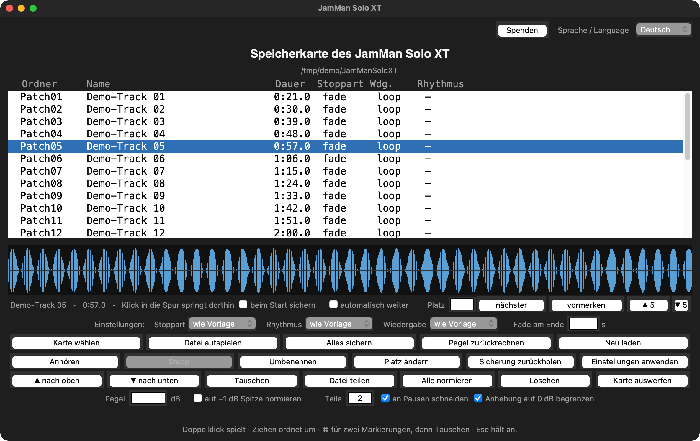

# jamman-card-tool — deutsche Anleitung

Die Speicherkarte des **DigiTech JamMan Solo XT und Stereo** von macOS,
Windows oder Linux aus verwalten — ohne JamManager XT.

*English version: [README.md](README.md) · Seite mit Bildern:
https://www.julius-k.de/tool/*

Karten des **JamMan Stereo** werden ebenfalls erkannt: gleicher Aufbau,
nur heißt der Geräteordner `JamManStereo`. Geprüft mit einer nachgebauten
Stereo-Karte und seit 13.11.2026 **von einem Nutzer an einem echten
JamMan Stereo (Kubuntu) bestätigt** ("Funktioniert, top.") — trotzdem
vor dem ersten Schreiben die Karte kopieren.

**Hintergrund:** Das offizielle Programm *JamManager XT* (Version 2.0 von
2012) stürzt auf aktuellen macOS-Versionen ab, sobald das Pedal erkannt
wird (`Tcl_Panic` in `TkpInit`), und wird nicht mehr gepflegt. Dieses
Werkzeug arbeitet **direkt auf der Speicherkarte**. Dafür muß die microSD
aus dem Pedal heraus und in einen Kartenleser oder Kartenslot — über das
USB-Kabel meldet sich das Pedal unter aktuellen macOS-Versionen nicht als
Laufwerk. Kein Windows, kein Rosetta, kein Emulator.

Reines Python 3 mit der Standardbibliothek. Kein ffmpeg, kein Homebrew.

---



## Neue Fassungen

Beim Öffnen des Fensters fragt das Werkzeug **einmal am Tag** bei GitHub nach
der neuesten Fassung. Ist sie neuer als die laufende, erscheint ein Hinweis mit
dem Angebot, die Download-Seite zu öffnen. Die Abfrage läuft im Hintergrund —
ohne Netz öffnet sich das Fenster genauso schnell, und es wird nichts gemeldet.

Übertragen wird dabei nur die Anfrage an `api.github.com`: keine Karte, keine
Dateinamen, kein Benutzername.

Abschalten: in der Einstellungsdatei (Pfad zeigt `jamman.py selbsttest`) die
Zeile

```
update_pruefung=nein
```

eintragen.

## Was es kann

| Befehl | Wirkung |
|---|---|
| `liste` | Patches auflisten: Name, Dauer, WAV-Format |
| `abspielen --patch N` | einen Patch anhören |
| `aufspielen --wav DATEI` | Datei als neuen Patch anlegen (wandelt auf 44,1 kHz / 16 Bit / Stereo) |
| `aendern --patch N` | Stopp-Verhalten, Loop/Single, Rhythmus oder Namen ändern |
| `verschieben --patch N --nach M` | Patch an eine andere Stelle schieben |
| `loeschen --patch N` | Patch entfernen (vorher Sicherung) |
| `sichern --ziel ORDNER` | die ganze Karte auf den Rechner kopieren |
| `saeubern` | macOS-Dateien (`._*`, `.DS_Store`) von der Karte entfernen |
| `auswerfen` | Karte abmelden |
| `gui` | kleines Fenster (tkinter) |
| `menu` | Textmenü — braucht kein tkinter |

**Ohne `--schreiben` wird nichts verändert** (Trockenlauf).
**Vor jedem Schreibvorgang** werden die betroffenen Patches nach
`~/JamMan-Sicherung` gesichert.

---

## Aufbau der Karte

An echter Hardware geprüft (26.10.2026):

```
JamManSoloXT/
    Patch01/
        patch.xml          <PatchName>, <RhythmType>, <StopMode>, <ID>
        PhraseA/
            phrase.wav     44,1 kHz, 16 Bit, Stereo, PCM
            phrase.xml     <IsLoop> (Single/Loop), Tempo, <ID>
    Patch02/
    ...
```

Der Platz ergibt sich aus dem Ordnernamen: `Patch07` erscheint im Pedal
als Patch 7. **Die Namen gehören dem Gerät** — das Werkzeug erfindet keine
neuen.

Auf der Karte gibt es zwei Stopp-Arten: `FadeOut` und `StopInstantly`,
und zwei Rhythmen: `Silence` und `StudioKickAndHighHat` (letzterer
gehört zu `<SettingsVersion>1</SettingsVersion>`).

---

## Herunterladen

```
git clone https://github.com/Suilui1/jamman-card-tool.git
```

Oder auf der Projektseite "Code" → "Download ZIP".

## Voraussetzungen

* **Python 3** mit tkinter — tkinter nur für das Fenster; `menu` braucht es nicht

| System | Python | Start |
|---|---|---|
| macOS | `xcode-select --install` oder Python von [python.org](https://www.python.org/downloads/) | `JamMan.command` |
| Windows | Python von [python.org](https://www.python.org/downloads/) („Add python.exe to PATH") | `JamMan.bat` |
| Linux | `sudo apt install python3-tk` | `./JamMan.sh` |

Für den Ton nimmt es, was da ist: `afplay` (macOS), `winsound` (Windows),
`aplay`/`paplay`/`mpv`/`ffplay` (Linux).

**MP3 und M4A unter Windows:** Das Pedal nimmt nur WAV. Zum Umwandeln
braucht Windows `ffmpeg`:

```
winget install --id Gyan.FFmpeg
```

oder `ffmpeg.exe` einfach neben `jamman.py` legen. Mit WAV-Dateien geht es
auch ohne ffmpeg.

**Karte finden:** Das Werkzeug sucht selbst — macOS `/Volumes/*`,
Windows alle Laufwerksbuchstaben, Linux `/media/<benutzer>/*`,
`/run/media/<benutzer>/*`, `/mnt/*`.

**Was geprüft ist und was nicht:**

| System | Stand |
|---|---|
| macOS (Apple Silicon) | vollständig geprüft, täglich im Einsatz |
| macOS (Intel) | gleicher Code, gleiche Python-Version — erwartet, **nicht** geprüft |
| Windows | Ton über `winsound`, Kartenfindung über Laufwerke — **nicht** auf einem Windows-Rechner geprüft |
| Linux | Ton über `aplay`/`paplay`, Kartenfindung über `/media` — **nicht** auf einem Linux-Rechner geprüft |
| Android | **geht nicht**: Tkinter gibt es dort nicht, und Android kann die Karte nicht beschreibend einbinden. Das wäre eine neue App, keine Portierung. |

Wenn etwas fehlt, sagt es `jamman.py selbsttest`: System, Tonprogramm,
Kartenwurzeln und Schrift stehen dann in der Ausgabe.

---

## Befehlsnamen

Jeder Befehl existiert auf Deutsch und auf Englisch:

| Aufgabe | Befehle |
|---|---|
| Patches auflisten | `liste` · `list` |
| Karte sichern | `sichern` · `backup` |
| Datei aufspielen | `aufspielen` · `import` |
| Patch anhören | `abspielen` · `play` |
| Patch löschen | `loeschen` · `delete` |
| verschieben / tauschen / platzieren | `verschieben` · `move`, `tauschen` · `swap`, `platzieren` · `place` |
| aus Sicherung zurückholen | `zuruecknehmen` · `restore` |
| alle normieren | `alle-normieren` · `normalize` |
| Pegel zurücknehmen | `pegel-umkehren` · `undo-level` |
| Datei teilen | `teilen` · `split` |
| Patch ändern | `aendern` · `change` |
| aufräumen | `saeubern` · `clean` |
| Karte auswerfen | `auswerfen` · `eject` |
| Ordnernamen angleichen | `namensform` · `names` |
| Fenster / Textmenü | `gui` · `menu` |
| Selbsttest | `selbsttest` · `selftest` |

`--help` folgt der gewählten Sprache.

## Benutzung

```bash
# Karte eingelegt: /Volumes/JAMMAN oder D:\ oder /media/<benutzer>/JAMMAN
python3 jamman.py liste

# zuerst die ganze Karte sichern — immer eine gute Idee
python3 jamman.py sichern --ziel ~/JamMan-Sicherung --schreiben

# Datei als neuen Patch anlegen
python3 jamman.py aufspielen --wav meinloop.wav --name "Mein Loop" \
        --stopp fade --wiedergabe loop --schreiben

# vorhandenen Patch ändern
python3 jamman.py aendern --patch 7 --stopp fade --wiedergabe loop --schreiben

# verschieben / löschen
python3 jamman.py verschieben --patch 12 --nach 3 --schreiben
python3 jamman.py loeschen --patch 12 --schreiben

# fertig
python3 jamman.py auswerfen
```

Die Karte wird selbst gefunden. Mit `--karte /pfad/zur/karte` lässt sich
ein Pfad vorgeben.

---

## Das 10-Minuten-Limit umgehen: Datei teilen

**Das Pedal nimmt höchstens 10 Minuten pro Loop an** (Handbuch Seite 60,
stereo). Längere Dateien landen zwar auf der Karte, erscheinen am Pedal
aber nicht — sie können sogar wieder verschwinden.

Das Werkzeug lehnt eine zu lange Datei deshalb ab und bietet drei Wege an:

| Weg | Aufruf | Ergebnis |
|---|---|---|
| kürzen | `--kuerzen` | eine Datei, auf 9:59 beschnitten (die letzten 12 ms ausgeblendet) |
| auf Länge schneiden | `--laenge 540` | eine Datei mit höchstens 540 s |
| **teilen** | `--teile 2` | **zwei Patches, jeder unter dem Limit** |

### Wie das Teilen arbeitet

```
python3 jamman.py split --wav aufnahme.wav --name "Stück" --teile 2
python3 jamman.py split --wav aufnahme.wav --name "Stück" --laenge 540
```

- `--teile N` teilt in N etwa gleich lange Stücke, `--laenge S` in Stücke
  von höchstens S Sekunden.
- Geschnitten wird **an Pausen**, wenn es welche gibt (±90 s um den
  rechnerischen Punkt). `--einfach` schneidet stattdessen gleichmäßig.
- Die Naht ist **sample-genau**: es geht kein Sample verloren, keines wird
  doppelt.
- Die Pause an der Naht wird **herausgenommen**, damit Teil 1 dort endet,
  wo der Ton aufhört, und Teil 2 dort beginnt, wo er wieder einsetzt.
  Mit `--mit-pause` bleibt sie stehen.
- Die Teile heißen `Stück 1/2`, `Stück 2/2` … und belegen die nächsten
  freien Plätze. **Jeder Teil muss für sich unter 10 Minuten bleiben** —
  das prüft das Werkzeug und kürzt notfalls.

Im Fenster ist es der Knopf **„Datei teilen"** mit dem Feld „Teile" und dem
Kästchen „an Pausen schneiden".

### Am Pedal zusammenspielen

Die Teile sind eigenständige Patches. Für den nahtlosen Übergang schaltet
das Pedal mit dem **FS3X-Fußschalter** weiter: den nächsten Loop **mindestens
2 Sekunden vor dem Ende** vorwählen (Handbuch Seite 57), dann schließt er
lückenlos an. Ohne FS3X geht es mit UP/DOWN von Hand — dann entsteht eine
kurze Pause.

Das Werkzeug macht dasselbe zum Prüfen: Kästchen „automatisch weiter" oder
Knopf „vormerken" spielt die Teile ohne Lücke hintereinander (Fassung 3.27
und später).

## Stand

| System | Stand |
|---|---|
| macOS 27, Apple Silicon | getestet, alle Funktionen |
| macOS 15, Intel (MacBook Pro 2012) | getestet, alle Funktionen |
| Windows 10 | **noch nicht getestet** — Rückmeldung willkommen |
| Linux | **noch nicht getestet** — Rückmeldung willkommen |

Auf manchen Intel-Macs bringt Apples Python 3.9 das alte Tk 8.5.9 mit, das
beim Öffnen eines Fensters abstürzt. `JamMan.command` erkennt das und
weicht auf das Textmenü aus; Python von python.org (Tk 8.6) bringt das
Fenster zurück.

---

## Sicherheit

Dieses Werkzeug schreibt auf eine Speicherkarte, von der ein Gerät lebt.

* Es sichert vor jedem Schreibvorgang — **trotzdem vor dem ersten
  Schreiben eine eigene Kopie** des Ordners `JamManSoloXT` ziehen.
* Nach jeder Änderung: Karte auswerfen, ins Pedal stecken, nachsehen.
  Was das Gerät wirklich macht, steht in keiner XML-Datei.
* Erst an einem Patch testen, dann an der ganzen Karte.
* Keine Gewährleistung. Siehe `LICENSE`.

Keine Verbindung zu DigiTech, Harman oder Samsung. Die Namen dienen nur
der Beschreibung, wofür das Werkzeug gedacht ist.

---

## Sprachen

Das Werkzeug spricht Deutsch, Englisch, Französisch, Spanisch und
Chinesisch. Drei Wege führen zur Sprache:

| Weg | Geltung |
|---|---|
| im Fenster: „Sprache / Language" oben rechts | dauerhaft (gespeichert in `~/.jamman-werkzeug.cnf`) |
| `--sprache en` auf der Kommandozeile | für diesen Lauf |
| ohne Angabe | Systemsprache aus `LANG`/`LC_ALL`, sonst Deutsch |

**Zum Stand der Übersetzungen:** Deutsch ist die Ausgangssprache,
Englisch ist vollständig und geprüft. Französisch, Spanisch und Chinesisch
sind übersetzt, aber **nicht von Muttersprachlern gegengelesen** — im
Fenster steht bei diesen Sprachen deshalb ein Hinweis. Korrekturen sind
willkommen: die Texte stehen als Wörterbuch oben in `jamman.py`
(`TEXTE`, Schlüssel ist der deutsche Satz).

Fehlt eine Übersetzung, erscheint der englische Text, sonst der deutsche.
Eine halbfertige Übersetzung führt also nie zu leeren Beschriftungen.

## Unterstützen

Das Werkzeug ist kostenlos. Wer es nützlich findet, darf gern etwas
beitragen:

**Spenden:** [paypal.com/donate … PEJEFMSKUPA8C](https://www.paypal.com/donate/?hosted_button_id=PEJEFMSKUPA8C&currency_code=EUR)

Der Knopf „Spenden" im Fenster öffnet dieselbe Seite. Die Kennung ist
öffentlich; Kontodaten stehen nicht darin.

## Lizenz

MIT — siehe [LICENSE](LICENSE).
Englische Anleitung: [README.md](README.md).
