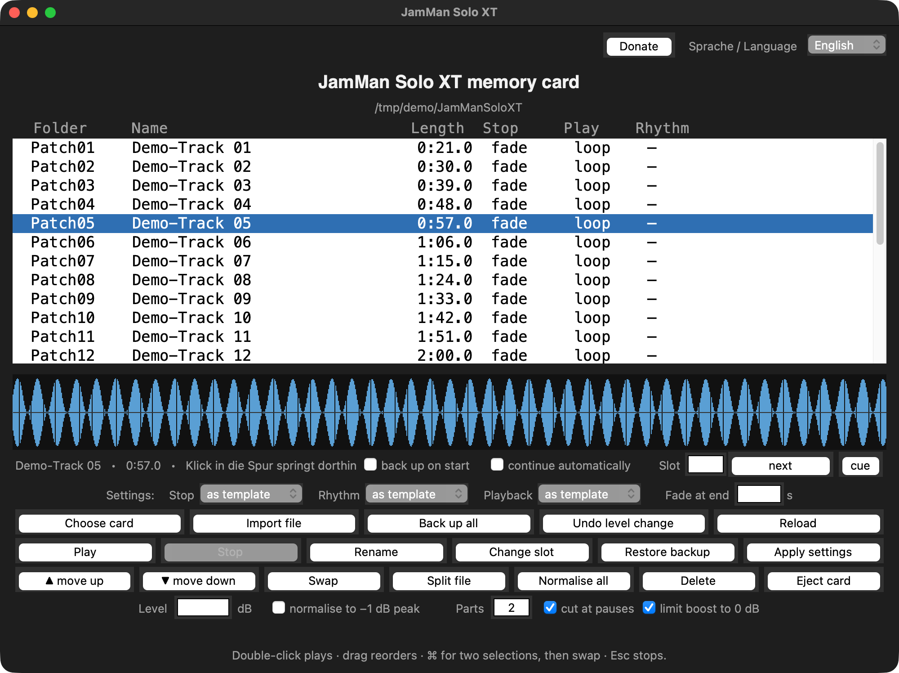

# jamman-card-tool

**Manage the SD card of a DigiTech JamMan Solo XT from macOS, Windows or Linux — without JamManager XT.**

Cards from the **JamMan Stereo** are also recognised: same folder layout, only the
device folder is called `JamManStereo`. Tested with a rebuilt Stereo card and, since
13 November 2026, **confirmed by a user on a real JamMan Stereo (Kubuntu)** —
still: copy the card before writing to it for the first time.

The official DigiTech *JamManager XT* (version 2.0, 2012) crashes on recent
macOS releases as soon as the pedal is connected:

```
Tcl_Panic -> TkpInit -> _tkinter -> Tk()   ->  SIGABRT
```

DigiTech does not maintain the software any more. This tool avoids it
completely: it works **directly on the SD card**. For that the microSD has
to come out of the pedal and go into a card reader or slot — with the USB
cable attached, the pedal does not show up as a drive on current macOS
versions.

Everything is plain Python 3 with the standard library only.
No ffmpeg, no Homebrew, no build step.

---



## New versions

When the window opens, the tool asks GitHub **once a day** for the latest
release. If it is newer than the running copy, a hint appears offering to open
the download page. The request runs in the background — without a network the
window opens just as fast and nothing is reported.

All that is sent is the request to `api.github.com`: no card, no file names,
no user name.

To switch it off, put

```
update_pruefung=nein
```

into the settings file (its path is printed by `jamman.py selbsttest`).

## What it does

| Command | Effect |
|---|---|
| `liste` | list the patches on the card: name, length, WAV format |
| `abspielen --patch N` | play a patch |
| `aufspielen --wav FILE` | add a file as a new patch — WAV, AIFF, CAF, MP3, M4A/AAC, FLAC, OGG/Opus; converts to 44.1 kHz / 16 bit / stereo |
| `aendern --patch N` | change stop mode, loop/single, rhythm or name of an existing patch |
| `verschieben --patch N --nach M` | move a patch to another slot |
| `loeschen --patch N` | remove a patch (backup first) |
| `sichern --ziel DIR` | copy the whole card to the computer |
| `saeubern` | remove macOS `._*` and `.DS_Store` files from the card |
| `auswerfen` | unmount / eject the card |
| `gui` | small window (tkinter) |
| `menu` | text menu — works without tkinter |

**Dry run by default.** Nothing is written unless you add `--schreiben`.

**Backup before every write.** Each writing command copies the affected
patch folders to `~/JamMan-Sicherung` first.

---

## Card layout

Verified on real hardware (2026-10-26):

```
JamManSoloXT/
    Patch01/
        patch.xml          <PatchName>, <RhythmType>, <StopMode>, <ID>
        PhraseA/
            phrase.wav     44.1 kHz, 16 bit, stereo, PCM
            phrase.xml     <IsLoop> (single/loop), tempo, <ID>
    Patch02/
    ...
```

The slot is defined by the folder name: the pedal shows `Patch07` as
patch 7. Names belong to the device — the tool never invents new ones.

Two stop modes exist on the card: `FadeOut` and `StopInstantly`.
Two rhythm types: `Silence` and `StudioKickAndHighHat`
(the latter pairs with `<SettingsVersion>1</SettingsVersion>`).

---

## Download

```
git clone https://github.com/Suilui1/jamman-card-tool.git
```

Or use "Code" → "Download ZIP" on the project page.

## Requirements

* **Python 3** with tkinter (only for the window; the `menu` command needs no tkinter)

| System | Python | Start |
|---|---|---|
| macOS | `xcode-select --install`, or Python from [python.org](https://www.python.org/downloads/) | `JamMan.command` |
| Windows | Python from [python.org](https://www.python.org/downloads/) ("Add python.exe to PATH") | `JamMan.bat` |
| Linux | `sudo apt install python3-tk` | `./JamMan.sh` |

Audio playback uses what the system has: `afplay` (macOS), `winsound`
(Windows), `aplay`/`paplay`/`mpv`/`ffplay` (Linux).

**MP3 and M4A on Windows:** the pedal only takes WAV. Windows needs
`ffmpeg` for other formats:

```
winget install --id Gyan.FFmpeg
```

or drop `ffmpeg.exe` next to `jamman.py`. Plain WAV works without ffmpeg.

**Finding the card:** macOS `/Volumes/*`, Windows every drive letter,
Linux `/media/<user>/*`, `/run/media/<user>/*`, `/mnt/*`.

**What is tested and what is not:**

| System | State |
|---|---|
| macOS (Apple Silicon) | fully tested, in daily use |
| macOS (Intel) | same code, same Python — expected to work, **not** tested |
| Windows | audio via `winsound`, card search via drive letters — **not** tested on a Windows machine |
| Linux | audio via `aplay`/`paplay`, card search via `/media` — **not** tested on a Linux machine |
| Android | **not possible**: no tkinter, and Android cannot mount the card writable. That would be a new app, not a port. |

`jamman.py selbsttest` prints the system, the audio program, the card
search roots and the font it would use.

---

## Command names

Every command exists in German and in English — the English alias is
listed second:

| Task | Commands |
|---|---|
| list patches | `liste` · `list` |
| back up the card | `sichern` · `backup` |
| import a file | `aufspielen` · `import` |
| play a patch | `abspielen` · `play` |
| delete a patch | `loeschen` · `delete` |
| move / swap / place | `verschieben` · `move`, `tauschen` · `swap`, `platzieren` · `place` |
| restore a backup | `zuruecknehmen` · `restore` |
| normalise all | `alle-normieren` · `normalize` |
| undo a level change | `pegel-umkehren` · `undo-level` |
| split a file | `teilen` · `split` |
| change a patch | `aendern` · `change` |
| clean clutter | `saeubern` · `clean` |
| eject the card | `auswerfen` · `eject` |
| normalise folder names | `namensform` · `names` |
| window / text menu | `gui` · `menu` |
| self test | `selbsttest` · `selftest` |

`--help` follows the chosen language.

## Usage

```bash
# card inserted, e.g. /Volumes/JAMMAN or D:\ or /media/<user>/JAMMAN
python3 jamman.py liste

# back up the whole card first — always a good idea
python3 jamman.py sichern --ziel ~/JamMan-Sicherung --schreiben

# add a file as a new patch
python3 jamman.py aufspielen --wav myloop.wav --name "My Loop" \
        --stopp fade --wiedergabe loop --schreiben

# change an existing patch
python3 jamman.py aendern --patch 7 --stopp fade --wiedergabe loop --schreiben

# move / delete
python3 jamman.py verschieben --patch 12 --nach 3 --schreiben
python3 jamman.py loeschen --patch 12 --schreiben

# done
python3 jamman.py auswerfen
```

The card is found automatically. To point at a specific path use
`--karte /path/to/card`.

---

## Working around the 10-minute limit: splitting a file

**The pedal accepts at most 10 minutes per loop** (manual page 60,
stereo). Longer files do land on the card, but the pedal does not show
them — they can even disappear again.

The tool therefore refuses a file that is too long and offers three ways
out:

| Way | Option | Result |
|---|---|---|
| shorten | `--kuerzen` | one file cut to 9:59 (last 12 ms faded out) |
| cut to length | `--laenge 540` | one file of at most 540 s |
| **split** | `--teile 2` | **two patches, each below the limit** |

### How splitting works

```
python3 jamman.py split --wav recording.wav --name "Piece" --teile 2
python3 jamman.py split --wav recording.wav --name "Piece" --laenge 540
```

- `--teile N` makes N roughly equal parts, `--laenge S` parts of at most
  S seconds.
- Cuts are placed **at pauses** when there are any (within ±90 s of the
  calculated point). `--einfach` cuts evenly instead.
- The seam is **sample-exact**: no sample is lost, none is doubled.
- The pause at the seam is **removed**, so part 1 ends where the sound
  stops and part 2 begins where it resumes. `--mit-pause` keeps it.
- The parts are named `Piece 1/2`, `Piece 2/2` … and take the next free
  slots. **Each part must stay below 10 minutes on its own** — the tool
  checks that and shortens if needed.

In the window this is the **"Split file"** button with the field "Parts"
and the tick box "cut at pauses".

### Playing the parts back to back on the pedal

The parts are ordinary patches. For a gapless join the pedal switches with
the **FS3X footswitch**: cue the next loop **at least 2 seconds before the
end** (manual page 57), then it continues without a gap. Without an FS3X
you press UP/DOWN by hand — that leaves a short pause.

The tool does the same for checking: the tick box "continue automatically"
or the "cue" button plays the parts without a gap (version 3.27 and later).

## Status

| System | Status |
|---|---|
| macOS 27, Apple Silicon | tested, all functions |
| macOS 15, Intel (MacBook Pro 2012) | tested, all functions |
| Windows 10 | **not tested yet** — please report |
| Linux | **not tested yet** — please report |

On some Intel Macs Apple's bundled Python 3.9 ships with Tk 8.5.9, which
aborts when opening a window. `JamMan.command` detects this and falls
back to the text menu; installing Python from python.org (Tk 8.6) brings
the window back.

---

## Safety

This tool writes to a memory card that a device depends on.

* It always backs up before writing — but **make your own copy of the
  `JamManSoloXT` folder before the first write**, no matter what.
* After every change: eject the card, put it into the pedal, and look.
  What the device actually does is not written in any XML file.
* Test on one patch before changing a whole card.
* No warranty. See `LICENSE`.

Not affiliated with DigiTech, Harman or Samsung. The names are used only
to describe what this is for.

---

## Languages

German, English, French, Spanish and Chinese. Three ways to pick one:

| Way | Scope |
|---|---|
| in the window: "Sprache / Language" (top right) | permanent (`~/.jamman-werkzeug.cnf`) |
| `--sprache en` on the command line | this run only |
| no choice | system language from `LANG`/`LC_ALL`, else German |

**About the translations:** German is the source, English is complete and
checked. French, Spanish and Chinese are translated but **not reviewed by
native speakers** — the window shows a note for those languages.
Corrections are welcome: the texts are a dictionary near the top of
`jamman.py` (`TEXTE`, keyed by the German sentence).

A missing entry falls back to English, then to German, so a half-finished
translation never leaves empty labels.

## License

MIT — see [LICENSE](LICENSE).

German documentation: [README.de.md](README.de.md).

## Support

The tool is free. If you find it useful you may contribute something:

**Donate:** [paypal.com/donate … PEJEFMSKUPA8C](https://www.paypal.com/donate/?hosted_button_id=PEJEFMSKUPA8C&currency_code=EUR)

The "Donate" button in the window opens the same page. The identifier is
public; no account details are in it.
